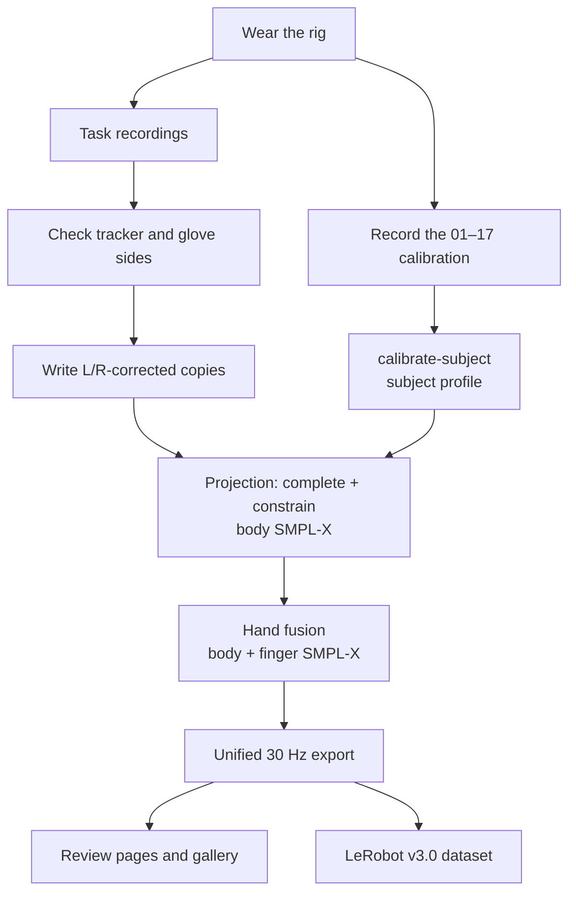

# 0. Overview

[Back to contents](../index.md#english) · [中文](../zh/00_overview.md)

EgoExplorer records people working and moving through real spaces with a wearable rig: five trackers, a pair of gloves and a head-mounted camera, worn in a laboratory, a factory bay, a living room, a study or a kitchen. The rig records four streams at once; the processing pipeline turns them into an SMPL-X body with fingers and aligns everything on one timeline.

<video src="../../assets/video/session_weighing.mp4" controls muted loop playsinline width="100%"></video>

*One weighing recording at 5× speed: egocentric video, whole-body motion, hand skeletons with touch, and the step description on one timeline.*

## 0.1 Four streams

| | Stream | Device | Native rate (measured) |
|---|---|---|---|
| A | Egocentric video | GoPro HERO13 Black + Media Mod, rigidly coupled to the head tracker | about 30 Hz on the Wuji rig; about 52–60 Hz on the MANUS rig |
| B | Whole-body motion | 5 VIVE Ultimate Trackers: head, backs of both hands, outer side of both ankles | about 65 Hz on the Wuji rig; 90 Hz by default on the MANUS rig (older recordings about 15 Hz) |
| C | Finger articulation | MANUS Metagloves Pro or Wuji gloves | MANUS about 220 Hz (older 25-node exports about 22 Hz); Wuji about 120 Hz |
| D | Touch | Wuji gloves, 24 × 31 = 744 taxels per hand | about 120 Hz |

## 0.2 Processing

Five trackers alone do not determine a whole-body pose. Reconstruction has three steps (C³, Calibrate–Complete–Constrain):

1. **Calibrate**: after each donning, a short prescribed sequence gives body shape, scale and the mounting of the five trackers; every later recording reuses that result.
2. **Complete**: a temporal network turns the five trackers into a first whole-body trajectory, filling in the joints no tracker sees.
3. **Constrain**: that trajectory is optimised against three sets of constraints: the trackers, the body's own surface and the floor.

The glove's finger poses and touch are then attached to the same body, and everything is resampled to 30 Hz.

The whole processing pipeline runs on one machine; an NVIDIA GPU is recommended.

## 0.3 Code

The code is at [InternRobotics/egoexplorer-toolkit](https://github.com/InternRobotics/egoexplorer-toolkit).

| Folder | Contents |
|---|---|
| `capture/` | Capture program for Wuji and MANUS gloves (chapters 2–4) |
| `src/five_tracker_smplx/` | Library: data loading, coordinate conventions, calibration, SMPL-X fitting, hand fusion |
| `scripts/` | One script per processing stage; single-machine driver `scripts/run_pipeline.sh` |
| `tactile/` | Wuji touch processing and the glove health table |
| `ckpt/` | Weights of the completion network |
| `assets/` | Calibration reference motion and reference video |
| `hardware/` | Bill of materials and 3D-printed parts |
| `models/` | SMPL-X and VPoser, downloaded from the official site (7.2) |

## 0.4 Where to start

- **Building the rig and organising capture**: chapters 1–5.
- **Processing existing data**: chapters 6–10.
- **Before writing code that reads the data**: read chapter 11 (coordinates) and section 12.2. Three things go wrong most often: the streams never share a sample rate; some timestamps are relative and others absolute; raw and released files store quaternions in different orders.
