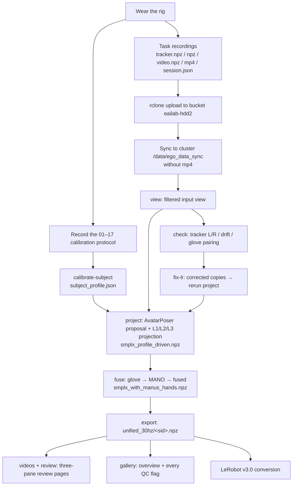

# 0. Overview and data flow

[Back to contents](../../README.md#english) · [中文](../zh/00_overview.md)

## 0.1 What the system does

A person wears a light rig and works in real rooms (laboratory, factory bay, living room, study, kitchen) while walking around. Four streams are recorded together:

| | Stream | Device | Native rate (measured) |
|---|---|---|---|
| A | Egocentric video | GoPro HERO13 Black + Media Mod, rigidly coupled to the head tracker through a 3D-printed adapter | ~30 Hz on the Wuji rig; ~52–60 Hz on the MANUS rig |
| B | Whole-body motion | 5 × VIVE Ultimate Tracker (head, both wrists, both lateral ankles), inside-out, no base stations | ~65 Hz on the Wuji rig; ~15 Hz on the MANUS rig (see chapter 12) |
| C | Finger articulation | MANUS Metagloves Pro **or** Wuji gloves | MANUS ~22 Hz (old 25-node) / ~220 Hz (new 21-node); Wuji ~120 Hz |
| D | Touch | Wuji glove, 24×31 = 744 taxels per hand | ~120 Hz |

The **C³ (Calibrate–Complete–Constrain)** pipeline then turns the five sparse trackers into a complete, metric, physically plausible SMPL-X body, and fuses the gloves' finger poses and touch onto the same body and the same clock.

## 0.2 Data flow

## 0.3 Where things live

| Item | Location |
|---|---|
| Pipeline code (H cluster) | `~/workspace/five_tracker_smplx` (`src/five_tracker_smplx/` library + `scripts/`) |
| Local development copies | `robotics/five_tracker_smplx` (library), `fivetrackerlocal/cluster_batch/` (batch scripts, deployed to the cluster's `scripts/`) |
| Full v3 archive (reproducible offline) | bucket `eailab-hdd2:/eailab/code/five_tracker_v3`: `code/` + `ckpt/` + `env/` (offline wheelhouse) + `batch_v3/` (outputs) |
| Single source of truth for the v3 config | `scripts/batch_v3_env.sh` |
| Batch entry point | `scripts/run_batch_v3.sh <stage>` |
| Raw recordings | bucket `eailab-hdd2:/eailab/ego_data/<dataset>/`; cluster copy `/data/ego_data_sync/<dataset>/` (no mp4) |
| Recorder code | `record_ego/` (capture program) + `devices/` (device drivers), see chapter 3 |

## 0.4 How to read this guide

- Building a rig or organising a capture: chapters 1–5.
- Processing existing data: chapters 6–10, together with chapter 11 (coordinates) and chapter 12 (cluster and pitfalls).
- Before writing any code that reads these npz files, **read chapter 11 and section 12.3**: sample rates never agree, some timestamps are relative and some absolute, and the quaternion order differs between raw and released files.
