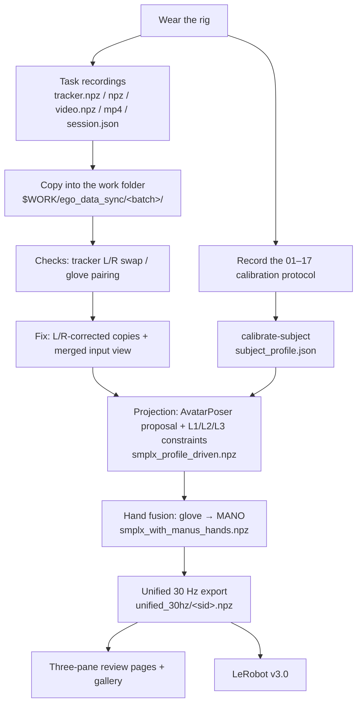

# 0. Overview and data flow

[Back to contents](../index.md#english) · [中文](../zh/00_overview.md)

## 0.1 What the system does

A person wears a light rig and works in real rooms (laboratory, factory bay, living room, study, kitchen) while walking around. Four streams are recorded together:

| | Stream | Device | Native rate (measured) |
|---|---|---|---|
| A | Egocentric video | GoPro HERO13 Black + Media Mod, rigidly coupled to the head tracker through a 3D-printed adapter | ~30 Hz on the Wuji rig; ~52–60 Hz on the MANUS rig |
| B | Whole-body motion | 5 × VIVE Ultimate Tracker (head, both wrists, both lateral ankles), inside-out, no base stations | ~65 Hz on the Wuji rig; 90 Hz by default on the MANUS rig (older recordings ~15 Hz, see 2.2.3) |
| C | Finger articulation | MANUS Metagloves Pro **or** Wuji gloves | MANUS ~22 Hz (old 25-node) / ~220 Hz (new 21-node); Wuji ~120 Hz |
| D | Touch | Wuji glove, 24×31 = 744 taxels per hand | ~120 Hz |

The **C³ (Calibrate–Complete–Constrain)** pipeline then turns the five sparse trackers into a complete, metric, physically plausible SMPL-X body, and fuses the gloves' finger poses and touch onto the same body and the same clock.

<video src="../../assets/video/session_weighing.mp4" controls muted loop playsinline width="100%"></video>

*One recording (weighing, 5× speed): egocentric video, whole-body motion, hand skeletons with touch, and the step description, all on one timeline.*

**The whole processing pipeline runs on one machine** (an NVIDIA GPU is recommended); no cluster is needed.

## 0.2 Data flow

## 0.3 What is in the toolkit

Code repository: [InternRobotics/egoexplorer-toolkit](https://github.com/InternRobotics/egoexplorer-toolkit).

| Part | Contents |
|---|---|
| `capture/` | Capture program: Wuji and MANUS rigs, Windows tracker sender, session replay (chapters 2–4) |
| `src/five_tracker_smplx/` | Library: data loading, coordinate contract, calibration, SMPL-X fitting, hand mapping, viewers |
| `scripts/` | Stage scripts: projection, checks, fixes, export, review pages, gallery, training |
| `ckpt/` | v3 proposal network checkpoint |
| `models/` | SMPL-X, VPoser (download from the official sites, see 7.2) |
| `hardware/` | Bill of materials and 3D-printed parts (to be completed) |

## 0.4 How to read this guide

- Building a rig or organising a capture: chapters 1–5.
- Processing existing data: chapters 6–10, together with chapter 11 (coordinates) and chapter 12 (environment and pitfalls).
- Before writing any code that reads these npz files, **read chapter 11 and section 12.2**: sample rates never agree, some timestamps are relative and some absolute, and the quaternion order differs between raw and released files.
