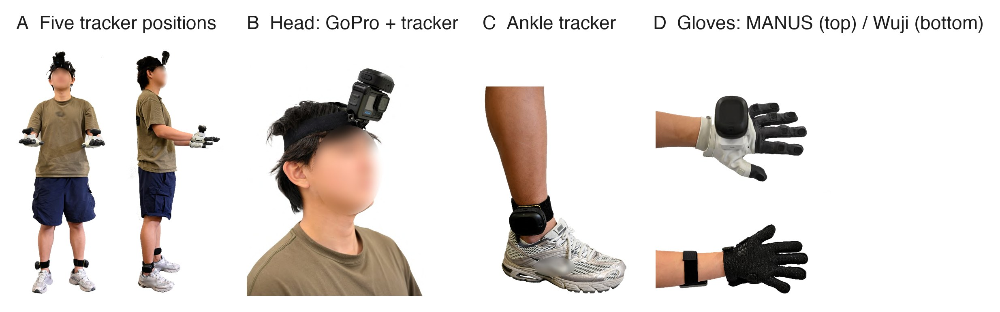

# 1. Hardware and wearing

[Back to contents](../index.md#english) · [中文](../zh/01_hardware_and_wearing.md)

## 1.1 Bill of materials

| Part | Model | Qty | Where to buy | Notes |
|---|---|---|---|---|
| Body trackers | VIVE Ultimate Tracker (with wireless dongle) | 5 | [Taobao](https://e.tb.cn/h.j2riSa4h9gOXIbP?tk=bTaNTF8KLgN) | Camera-based tracking, no base stations |
| Head camera | GoPro HERO13 Black | 1 | [Taobao](https://e.tb.cn/h.jX74wO5kS7nAy2D?tk=eQhiTF8vq0V) | |
| Media module | GoPro Media Mod (HERO13/12/11) | 1 | [Taobao](https://e.tb.cn/h.jWg7Rd1eJVpQFGl?tk=sRXrTF8xGCs) | Provides the micro-HDMI output |
| HDMI capture card | UGREEN 4K60Hz USB capture card (UVC) | 1 | [JD](https://3.cn/37Yq-tog?jkl=@Q3DcI0h3Iu7W@) | Shows up as `/dev/videoN` on Linux |
| Video cable | micro-HDMI to HDMI | 1 | [JD](https://3.cn/37YriR-s?jkl=@XB71C3CgoM8X@) | |
| Gloves (one of) | MANUS Metagloves Pro | 1 pair | [MANUS website](https://www.manus-meta.com/); contact their sales team | Finger articulation only |
| | Wuji gloves | 1 pair | [Wuji website](https://wuji.tech/); contact their sales team | Finger articulation plus 24 × 31 touch per hand; Ethernet |
| USB Ethernet adapters | UGREEN USB 3.0 gigabit adapter | 2 | [JD](https://3.cn/37-YsP1x?jkl=@VER0R1iYlA3G@) | Wuji rig, one port per glove |
| Straps | VIVE tracker straps, GoPro head strap | 1 head strap, 4 straps | [Tracker straps](https://e.tb.cn/h.jX7EVqK0xb7nHvB?tk=vOtgTFj8BVK) · [GoPro head strap](https://e.tb.cn/h.jc684WNxd6oG6gN?tk=BdM7TFj9A15) | |
| Linux capture PC | Ubuntu 22.04 or later | 1 | — | Wuji rig only; a portable device works |
| Windows PC | runs SteamVR | 1 | — | Trackers only on the Wuji rig; the whole capture on the MANUS rig |

## 1.2 3D-printed parts

STL files and print settings go into `hardware/3d_print/` of [egoexplorer-toolkit](https://github.com/InternRobotics/egoexplorer-toolkit) (in progress).

| Part | Purpose | File | Qty |
|---|---|---|---|
| Head adapter | Couples the GoPro rigidly to the head tracker and mounts both on the head strap | `gopro-tracker.stl` | 1 |
| Hand base | Holds a tracker on the back of the glove | `wuji-contact.stl` | 2 |

## 1.3 Tracker roles

Each tracker gets a role in SteamVR. The capture program, the pipeline and the released data all use these names:

| SteamVR role | Name in the pipeline | Where it is worn | SMPL-X joint |
|---|---|---|---|
| `camera` | `head` | Head, rigidly coupled to the GoPro | 15 |
| `left_wrist` | `left_hand` | Back of the left hand | 20 |
| `right_wrist` | `right_hand` | Back of the right hand | 21 |
| `left_ankle` | `left_foot` | Outer side of the left ankle | 7 |
| `right_ankle` | `right_foot` | Outer side of the right ankle | 8 |

Left and right always mean the **wearer's own** left and right. Facing the wearer, their left hand is on your right. No step may swap roles according to the left and right of an image.

The head tracker and the GoPro are rigidly coupled, so the camera pose comes straight from the tracker and does not have to be estimated from the images afterwards. This only holds if the two never move relative to each other: tighten the adapter and keep the head strap snug. If the camera is knocked during a recording, its pose is no longer usable for that recording.

## 1.4 Putting the rig on

Two people work best: one wears the rig, the other checks.

1. **Measure height and arm span** (for a new person or before recalibrating). Arm span is middle fingertip to middle fingertip; measure each twice and average, and enter them in metres at calibration. Other measurements (shoulder width, upper arm, forearm, hand length) can be recorded for reference.
2. **Put on the gloves and check the sides.** Wuji gloves are told apart by serial number; confirm on the capture page that each hand shows on the correct side.
3. **Mount the hand trackers.** Place the base in the middle of the glove's back and strap it so the tracker does not wobble when the wrist moves. The left hand carries the tracker with SteamVR role `left_wrist`, and likewise on the right.
4. **Mount the ankle trackers** on the outer side of the ankle, above the ankle bone, tight enough that they neither turn nor slide when walking or squatting. Mind the roles.
5. **Put on the head strap, head tracker and GoPro.** Adjust the strap so nothing moves, with the camera pointing along a natural forward gaze.
6. **Take two mounting photos** (front and side); they help check tracker positions and orientations if something goes wrong.
7. **Check while standing still.** The wearer stands naturally for a few seconds. On the capture page, confirm that all five trackers are online without jumps, both gloves stream data and the video shows a picture (the page is shown in 3.4).

## 1.5 Wearing rules

!!! warning "These rules decide whether the data is usable"

    - **Calibration and task recordings must come from the same donning.** After removing a tracker, a slipped strap or a change of wearer, record a new calibration (chapter 5). A changed mounting cannot be corrected afterwards.
    - **Do not adjust trackers between tasks.** Each donning has one set of mounting parameters.
    - **Sides must match the SteamVR roles.** Swapped trackers make the SMPL-X solve fail.
    - **Keep the straps tight.** A tracker that slowly slides looks normal frame by frame, and the error is quietly absorbed into the body pose.

**Wuji touch.** The gloves' touch sensitivity drops slowly with use, and some lines become intermittent. Run a touch calibration in Wuji Studio (about 15 seconds) once a day before capturing, so the glove's condition can be tracked.
