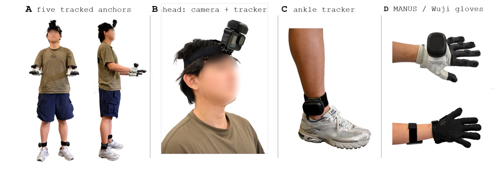

# 1. Hardware and wearing

[Back to contents](../index.md#english) · [中文](../zh/01_hardware_and_wearing.md)

*A: the five tracker positions (head, backs of both hands, both lateral ankles); B: the head GoPro rigidly coupled to the head tracker; C: ankle tracker; D: MANUS glove (top) and Wuji glove (bottom).*

## 1.1 Bill of materials

> **To be completed**: purchase links for the gloves will be filled in by the colleague in charge of hardware.

| Part | Model / spec | Qty | Purchase link | Notes |
|---|---|---|---|---|
| Body trackers | VIVE Ultimate Tracker (with wireless dongle) | 5 | [VIVE Ultimate Tracker (Taobao)](https://e.tb.cn/h.j2riSa4h9gOXIbP?tk=bTaNTF8KLgN) | Inside-out tracking, **no base stations** |
| Head camera | GoPro HERO13 Black | 1 | [GoPro HERO13 Black (Taobao)](https://e.tb.cn/h.jX74wO5kS7nAy2D?tk=eQhiTF8vq0V) | |
| Media module | GoPro Media Mod (for HERO13/12/11) | 1 | [GoPro Media Mod (Taobao)](https://e.tb.cn/h.jWg7Rd1eJVpQFGl?tk=sRXrTF8xGCs) | Provides the micro-HDMI output |
| HDMI capture card | UGREEN 4K60Hz USB UVC capture card | 1 | [HDMI capture card (JD)](https://3.cn/37Yq-tog?jkl=@Q3DcI0h3Iu7W@) | `/dev/videoN` on Linux |
| micro-HDMI → HDMI cable | Micro HDMI to HDMI cable | 1 | [micro-HDMI cable (JD)](https://3.cn/37YriR-s?jkl=@XB71C3CgoM8X@) | |
| Gloves (one of) | MANUS Metagloves Pro | 1 pair | — | Finger articulation only, no touch |
| | Wuji gloves | 1 pair | — | Finger articulation + 24×31 touch per hand; connected over Ethernet |
| USB Ethernet dock | UGREEN USB 3.0 gigabit Ethernet dock | 2 | [USB Ethernet dock (JD)](https://3.cn/37-YsP1x?jkl=@VER0R1iYlA3G@) | One port per Wuji glove |
| Head strap, straps | VIVE tracker straps; GoPro head strap | several | [Tracker straps (Taobao)](https://e.tb.cn/h.jX7EVqK0xb7nHvB?tk=vOtgTFj8BVK) [GoPro head strap (Taobao)](https://e.tb.cn/h.jc684WNxd6oG6gN?tk=BdM7TFj9A15) | 1 head strap, 2 hand straps, 2 ankle straps |
| Linux capture PC (Wuji rig) | Ubuntu 22.04+ | 1 | — | Can be a portable device |
| Windows PC | runs SteamVR | 1 | — | Wuji rig: trackers only; MANUS rig: the whole capture |

## 1.2 3D-printed parts

> **To be completed**: STL files and print settings will go into `hardware/3d_print/` of the [egoexplorer-toolkit](https://github.com/InternRobotics/egoexplorer-toolkit) repository.

| Part | Purpose | File | Qty |
|---|---|---|---|
| Head adapter | Couples the GoPro **rigidly** to the head tracker, mounted on the head strap | gopro-tracker.stl | 1 |
| Hand base | Holds a tracker on the glove dorsum | wuji-contact.stl | 2 |

## 1.3 Tracker roles

Role names are fixed. The recorder, the pipeline and the release format all use the same names, and **no stage may swap them according to the left/right of an image**:

| Recorder role (SteamVR role) | Pipeline role | Where it is worn | SMPL-X anchor joint |
|---|---|---|---|
| `camera` | `head` | Head, rigidly coupled to the GoPro | 15 (head) |
| `left_wrist` | `left_hand` | Back of the subject's own left hand | 20 (left_wrist) |
| `right_wrist` | `right_hand` | Back of the subject's own right hand | 21 (right_wrist) |
| `left_ankle` | `left_foot` | Subject's own left lateral ankle | 7 (left_ankle) |
| `right_ankle` | `right_foot` | Subject's own right lateral ankle | 8 (right_ankle) |

"Left" always means the subject's own left. When you face the subject, their left hand is on your right; that is ordinary perspective, not a swap.

## 1.4 Why the camera is rigid to the head tracker

The head tracker measures the camera's 6-DoF pose directly, so the camera pose is a **measurement** rather than something solved later with visual SLAM. This only holds if the two never move relative to each other: tighten the adapter and keep the head strap snug. If the camera is knocked during a recording, its extrinsics are no longer trustworthy for that part.

## 1.5 Putting the rig on

Two people work best: one wears, one checks.

1. **Measure the subject** (new subject or new calibration round; cm, each measured twice and averaged): height, arm span (middle fingertip to middle fingertip), biacromial width, neck base to crotch, crotch to floor, left/right upper arm, left/right forearm, left/right hand length (wrist crease to middle fingertip), palm width, left/right ankle-tracker centre to floor. Record left and right separately if they differ noticeably. Calibration itself uses **height and arm span** (entered in metres); the rest are for reference.
2. **Put on the gloves and check left/right.** Wuji gloves are told apart by serial number; confirm on the recorder page that each hand shows on the correct side.
3. **Mount the hand trackers** at the centre of the glove dorsum, strapped so they do not wobble when the wrist moves. **The left hand must carry the tracker whose SteamVR role is `left_wrist`**, and likewise on the right.
4. **Mount the ankle trackers** on the lateral side above the ankle bone, strapped so they neither rotate nor slide when walking or squatting. Watch the roles.
5. **Put on the head strap + head tracker + GoPro**, adjusted so it does not move; the camera points along a natural forward gaze.
6. **Take two mounting photos** (front and side) showing where each tracker sits and how it is oriented; they help later debugging.
7. **Static self-check**: the subject stands naturally for a few seconds. On the recorder page, confirm all five trackers are online without dropouts, both gloves stream and the video shows a picture (see the screenshot in 4.4).

## 1.6 Wearing rules (these decide whether the data is usable)

- **Calibration and task recordings must come from the same donning.** After a tracker is removed and re-attached, a strap slips, or the subject changes, record a new calibration (chapter 5). No coordinate fix can compensate for an unknown mounting rotation after remounting.
- **Do not adjust trackers between tasks.** The mounting extrinsics (tracker translation and rotation relative to the bone) are solved once per donning.
- **Get left and right right.** Each tracker must be worn according to the role it is assigned in SteamVR; otherwise the SMPL-X solve is affected.
- **A loose strap is worse than none.** A tracker that slowly slides shows up as drift: every frame looks plausible and the optimiser quietly absorbs the error into body pose.
- **Wuji touch** degrades slowly with use, and some lines become intermittent. Redo the tactile calibration in Wuji Studio at the start of every recording (about 15 s of tactile calibration motion, so a per-session health estimate is possible).
