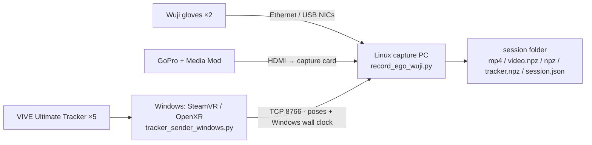
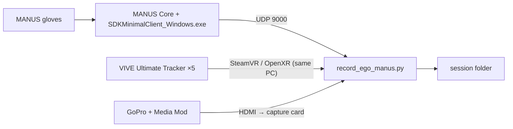

# 2. Capture host setup

[Back to contents](../index.md#english) · [中文](../zh/02_host_setup.md)

The capture code is in `capture/` of [egoexplorer-toolkit](https://github.com/InternRobotics/egoexplorer-toolkit). One code base supports both **Wuji** and **MANUS** gloves, with entry points `record_ego_wuji.py` and `record_ego_manus.py`.

## 2.1 Wuji rig: Linux capture PC + Windows tracker PC

### 2.1.1 Topology



- Linux is the only capture coordinator. Video and gloves are stamped with the Linux wall clock directly.
- Windows sends every pose with its own wall-clock time. Every 2 s the two sides take an NTP-style four-timestamp sample; Linux estimates the `Windows − Linux` offset from the lowest-RTT sample and converts tracker times to the Linux clock. Before the first estimate, and if an offset above 5 s is detected, it falls back to Linux receive time.
- Measured in-session drift is 4.2 ms median with 0.39 ms fit jitter.

### 2.1.2 Windows side: SteamVR and trackers

1. Install **VIVE Hub** and **SteamVR**, pair the five Ultimate Trackers with the dongle and build the play-area map following VIVE Hub (inside-out tracking needs it).
2. In SteamVR, **make SteamVR the active OpenXR Runtime**.
3. Assign each tracker a role: `camera`, `left_wrist`, `right_wrist`, `left_ankle`, `right_ankle`.
   - **A tracker with the role "Handheld object" yields no usable pose**; use the roles above.
   - The sender prints the serials and roles it enumerates at startup, which you can check against.
4. Install the Windows dependencies (just `numpy`, `msgpack`, `pyopenxr`):
   ```powershell
   python -m venv .venv-tracker
   .\.venv-tracker\Scripts\Activate.ps1
   python -m pip install -r requirements-tracker-windows.txt
   ```

**Tracker rate**: the sender sends at most 90 FPS by default (`--send-fps 90`) and Linux writes at most 120 FPS (`--tracker-record-fps`). The cap matters: some headless OpenXR runtimes return from `wait_frame` immediately, and without a cap they produce near-1000 FPS duplicate poses that starve glove reception on Linux.

### 2.1.3 Linux side

Ubuntu 22.04 or newer (required by the Wuji SDK), Python 3.10 / 3.11.

```bash
cd capture
python3 -m venv .venv && source .venv/bin/activate
python -m pip install -r requirements.txt      # numpy / opencv-python / msgpack / av / Pillow / wuji-sdk
```

**Connect the Wuji gloves.** Each glove uses its own Ethernet port (usually a USB Ethernet adapter); the factory addresses are `192.168.1.100` (left) and `192.168.1.101` (right). The setup script configures the NICs and routes and verifies the connection:

```bash
./scripts/setup_wuji_gloves.sh                     # detect ports, create persistent NetworkManager profiles, scan and connect
./scripts/setup_wuji_gloves.sh --check             # check only, change nothing
./scripts/setup_wuji_gloves.sh --interface enx001 --interface enx002   # name the NICs if auto-detection is ambiguous
./scripts/setup_wuji_gloves.sh --expected-gloves 2 --allow-ufw         # require both gloves; open SDK ports if UFW is on
```

The script never flushes existing addresses and never touches the NIC carrying the default route. If the glove IPs were changed, pass `--left-ip`, `--right-ip` and `--host-prefix`.

**Wuji glove calibration bundle**: every pair of Wuji gloves needs a hand calibration first (the SDK learns the hand model of these gloves and their wearer), stored under a Wuji SDK "user". At startup the recorder imports `wuji_calibration/calibration_bundle.zip` and switches to its owner user (`--wuji-calibration` for another path, `--no-wuji-calibration` to skip it and use the SDK's current user). The bundle is not in the repository; produce it like this:

1. Close Wuji Studio (it holds the SDK) and make sure `setup_wuji_gloves.sh --check` finds both gloves.
2. Create an SDK user to hold this pair's calibration (one per pair is enough):
   ```bash
   cd capture
   python scripts/wuji_calibration_tool.py users                  # existing users, * = current
   python scripts/wuji_calibration_tool.py create-user "rig-A"    # note the returned user_id
   ```
3. Calibrate (prefer 3.1; use 3.2 if Wuji Studio is not available):

   **3.1 Calibrate in Wuji Studio (recommended)**

   Open Wuji Studio, select the user created in the previous step and run the hand calibration for each glove following the [Wuji Studio documentation](https://docs.wuji.tech/docs/en/wuji-studio/latest/). When it is done, **close Wuji Studio** before exporting.

   **3.2 Calibrate with the script**

   ```bash
   python scripts/wuji_calibration_tool.py calibrate --user <user_id>
   ```
   This runs the SDK hand calibration for each glove; the terminal prints each requested pose (step name, state, hints) — follow them through.
4. Export:
   ```bash
   python scripts/wuji_calibration_tool.py export --user <user_id>   # -> wuji_calibration/calibration_bundle.zip
   python scripts/wuji_calibration_tool.py preview                   # validate the bundle without importing
   ```
5. Distribute: copy `calibration_bundle.zip` into `capture/wuji_calibration/` on the other capture machines; the recorder imports it at startup and prints the loaded calibration user. Use `wuji_calibration_tool.py import` to import by hand.

Requires `wuji-sdk>=2026.7.21`. Recalibrate and re-export after changing or repairing gloves.

**Capture card**:

```bash
sudo apt install v4l-utils
v4l2-ctl --list-devices
v4l2-ctl -d /dev/videoN --list-formats-ext
```

Frame grabbing and encoding run in separate threads joined by a bounded queue; MP4 PTS come from each frame's grab time `t_host_us` (variable frame rate), so dropped frames never compress the playback timeline.

**Firewall**: the Windows sender must reach TCP 8766 on Linux.

```bash
hostname -I                                               # Linux LAN IP
sudo ufw allow from <WINDOWS_IP> to any port 8766 proto tcp
```

Never expose 8766 to the internet; even on a trusted LAN, set the same `--tracker-token` (or `EGO_TRACKER_TOKEN`) on both sides.

### 2.1.4 Pre-capture checklist

- [ ] All five trackers online in SteamVR with the right roles
- [ ] `setup_wuji_gloves.sh --check` passes and both gloves scan; Wuji Studio is closed (it holds the SDK); `wuji_calibration/calibration_bundle.zip` belongs to this pair of gloves
- [ ] The recorder page shows "Tracker connected", with a camera preview and live tracker poses
- [ ] Enough free disk

## 2.2 MANUS rig: one Windows PC

### 2.2.1 Topology



All three streams are stamped on one machine and one wall clock, so they are aligned as written. The MANUS sender emits 25-node skeletons; the recorder drops the four non-thumb metacarpals and writes **21 nodes (the Wuji / MediaPipe layout)**.

### 2.2.2 MANUS Core and SDKMinimalClient

MANUS glove data passes through two programs before it reaches the recorder:

- **MANUS Core**: the official MANUS glove service, which connects the gloves, runs the hand calibration and solves the finger data. Download and install it from the [MANUS resources page](https://docs.manus-meta.com/3.0.0/Resources/) and pair and calibrate the gloves following the official instructions.
- **SDKMinimalClient** (`SDKMinimalClient_Windows.exe`): an exe built from the MANUS SDK sources. It pulls glove data from MANUS Core through the SDK and sends it over UDP to the recorder `record_ego_manus.py`. **To be confirmed**: the source and a prebuilt exe will be provided.

When capturing, start MANUS Core first and confirm the gloves are online, then start SDKMinimalClient, and start the recorder last.

### 2.2.3 SteamVR and trackers

Follow steps 1–3 of 2.1.2 to install VIVE Hub and SteamVR, pair the trackers, set the OpenXR runtime and assign roles. The trackers are read directly on this PC, so no separate sender environment is needed.

**Tracker rate**: the local trackers are sampled on the **host clock** (`--tracker-sample-fps`, default 90). The headless SteamVR compositor only runs at about 15 Hz, but `xrLocateSpace` can be queried at any time, so sampling is no longer tied to the frame cadence; a full wait/begin/end frame is only pumped every 0.5 s to keep the session alive. **Older MANUS recordings made before this fix have trackers at about 15 Hz** (6.5).

### 2.2.4 Capture PC setup

- Same `requirements.txt` (on Windows it installs `pyopenxr` and skips `wuji-sdk`).
- Prepare MANUS Core and the UDP sender as in 2.2.2.
- The capture card uses DirectShow on Windows.

### 2.2.5 Pre-capture checklist

- [ ] All five trackers online in SteamVR with the right roles
- [ ] The UDP sender is running with the right target IP / port
- [ ] The recorder page shows "Tracker connected", with a camera preview and live tracker poses
- [ ] Enough free disk
