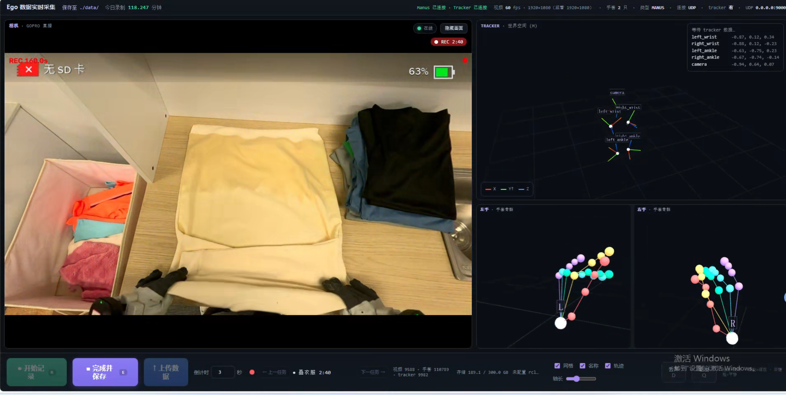

# 3. Capture program

[Back to contents](../index.md#english) · [中文](../zh/03_capture_scripts.md)

## 3.1 Code layout

```text
capture/
├── record_ego_wuji.py              Wuji rig entry point (Linux)
├── record_ego_manus.py             MANUS rig entry point (Windows)
├── record_ego_app.py               device connection, web server and recording flow
├── record_ego_page.html            control page
├── tracker_sender_windows.py       Windows tracker sender (Wuji rig)
├── visualize_session.py            replay one recording
├── record_ego/                     config, recording control, writing, upload
├── devices/                        device drivers
├── network_bridge/                 network protocol for tracker data
├── ManusClient/                    MANUS UDP sender (obtain separately; see the README in the folder)
├── wuji_calibration/               import and export of Wuji calibration bundles
├── scripts/
│   ├── setup_wuji_gloves.sh        Wuji glove network setup and checks
│   ├── wuji_calibration_tool.py    Wuji glove calibration and bundle export
│   ├── start_tracker_sender.ps1    starts the Windows tracker sender
│   ├── wuji_launch.sh              one-command Wuji launch (edit for your machine)
│   ├── rclone_linux.sh             upload data (Linux)
│   └── rclone_win.bat              upload data (Windows)
└── task_setting/example.json       task list example
```

## 3.2 Task list

`--task-setting` points to a JSON file holding an array of task names. The control page steps through them, and the task name goes into the recording name and `session.json`:

```json
["物料称量", "萃取", "开反应", "旋蒸", "烘箱取料", "过柱"]
```

## 3.3 Starting a capture

=== "Wuji rig"

    Start the capture program on Linux first:

    ```bash
    cd capture && source .venv/bin/activate
    python record_ego_wuji.py \
      --task-setting task_setting/example.json \
      --tracker-host 0.0.0.0 --tracker-port 8766 \
      --save-dir ./data
    ```

    Or edit `scripts/wuji_launch.sh` for your machine and use it.

    Then start the tracker sender on Windows, from `capture/`:

    ```powershell
    .\scripts\start_tracker_sender.ps1 -LinuxHost <LINUX_IP> -Port 8766
    # or
    python tracker_sender_windows.py --host <LINUX_IP> --port 8766
    ```

    - Port (and token, if set) must match on both sides. If the link drops, the Windows side reconnects every 2 seconds and Linux keeps recording video and gloves.
    - Windows only needs to let Python reach the LAN; no inbound port is needed.
    - Recording can also be controlled from the Windows terminal: `r` starts, `e` stops and saves, `Esc` turns off key listening (poses keep flowing). The countdown follows Linux's `--record-countdown` unless overridden with `-Countdown` / `--countdown`; use `-NoKeyboard` / `--no-keyboard` to disable keys.

=== "MANUS rig"

    Start MANUS Core and the UDP sender as in 2.4, then:

    ```bash
    python record_ego_manus.py \
      --task-setting task_setting/example.json \
      --manus-ip 0.0.0.0 --manus-port 9000
    ```

    Trackers are read on the same PC. Without trackers, add `--no-tracker`; the camera and gloves still record.

## 3.4 Control page

The control page is at `http://127.0.0.1:8770/` by default. To open it from another computer, add `--host 0.0.0.0` and open the port.

<div style="display:flex; gap:12px; align-items:flex-start" markdown>

<div style="flex:1.985 1 0; min-width:0" markdown>



*MANUS rig*

</div>

<div style="flex:1.778 1 0; min-width:0" markdown>


*Wuji rig*

</div>

</div>

Both pages share one layout: the GoPro view on the left, the five tracker poses and coordinates at the top right, both hand skeletons at the bottom right (plus 24 × 31 touch heat maps on the Wuji rig), and the controls at the bottom. On the Wuji page the camera preview is scaled to 640 × 360 by default (`--preview-width`, `--preview-height`); the recording resolution is unaffected.

The keys are the same as in the terminal:

| Key | Action |
|---|---|
| `r` | Start recording after a countdown (3 seconds by default, adjustable on the page) |
| `e` | Stop and save |
| `d` | During the countdown, cancel; while recording, stop and discard without writing |
| `q` | Quit; an unsaved recording is discarded |

## 3.5 Common options

| Option | Default | Meaning |
|---|---|---|
| `--cam-device` | `0` | Capture-card index or `/dev/video*` path |
| `--cam-width` `--cam-height` `--cam-fps` | `2560` `1440` `60` | Requested resolution and frame rate; the card's actual output is recorded in `session.json` |
| `--video-codec` `--crf` `--h264-preset` `--h264-threads` | `h264` `20` `ultrafast` `4` | Real-time H.264 encoding |
| `--no-camera` | | No camera |
| `--wuji-calibration` / `--no-wuji-calibration` | `wuji_calibration/calibration_bundle.zip` | Wuji glove calibration bundle |
| `--tracker-host` `--tracker-port` `--tracker-token` | `0.0.0.0` `8766` empty | Tracker receiver (Wuji rig) |
| `--tracker-record-fps` | `120` | Tracker write cap (Wuji rig) |
| `--tracker-sample-fps` | `90` | Tracker sampling rate (MANUS rig) |
| `--no-tracker` | | No trackers |
| `--save-dir` | `./data` | Folder for recordings |
| `--record-countdown` | `3` | Countdown before recording (seconds) |
| `--rclone-remote` `--rclone-config` | empty | Upload target (optional) |
| `--storage-limit-gb` `--storage-check-interval` | `50` `30` (minutes) | Above the limit, upload and clean up automatically |
| `--host` `--web-port` | `127.0.0.1` `8770` | Control page address and port |

Full lists: `python record_ego_wuji.py --help` and `python record_ego_manus.py --help`.

## 3.6 Upload (optional)

Recordings stay on the local `--save-dir` by default. When local space runs short, set up an S3-compatible object store (Aliyun OSS, Tencent COS, AWS S3 and so on) and upload with rclone:

1. Install [rclone](https://rclone.org/downloads/);
2. Run `rclone config` to create a remote, for example `myremote`, with the storage type, endpoint and keys;
3. Check that `rclone lsd myremote:<bucket>` lists the contents.

Then upload in either of two ways:

- **From the capture program.** Start it with `--rclone-remote myremote:<bucket>/ego_data` (or set `EGO_RCLONE_REMOTE`) and the page's upload button becomes active; it runs `rclone copy` and skips files already on the remote. When the data folder exceeds `--storage-limit-gb` (`0` disables the check), the program runs `rclone move` and deletes only local files confirmed as uploaded. Use `--rclone-bin` if rclone is not on PATH and `--rclone-config` if the config file is elsewhere.
- **With the scripts.** Set `LOCAL_PATH` and `REMOTE_PATH` at the top of `scripts/rclone_linux.sh` or `scripts/rclone_win.bat` and run it. For filtering or deleting local files after upload, edit the single rclone command in the script.

Without rclone, the upload button is inactive and nothing is cleaned up when the storage limit is exceeded, so keep an eye on disk space.

## 3.7 Common problems

| Symptom | Check in order |
|---|---|
| Linux keeps waiting for the tracker | The Windows `--host` is Linux's LAN IP (not 127.0.0.1); port and token match; `Test-NetConnection <LINUX_IP> -Port 8766` succeeds; Linux firewall; both machines on one subnet; Linux was started first |
| No tracker poses on Windows | Dependencies installed; SteamVR is the active OpenXR Runtime; trackers paired with roles assigned (not Handheld object) |
| Linux cannot find the Wuji gloves | `wuji-sdk` installed and nothing else holding the SDK; `setup_wuji_gloves.sh --check`; glove serials match the current SDK user's calibration |
