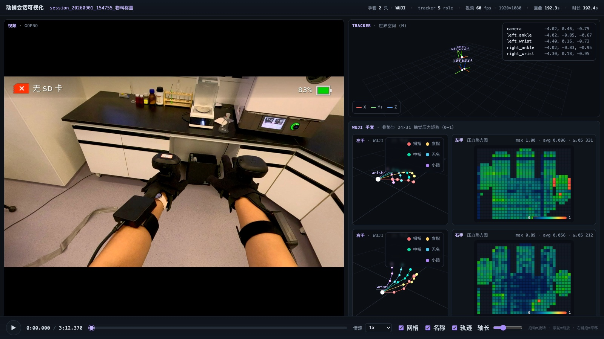

# 4. Collecting data

[Back to contents](../index.md#english) · [中文](../zh/04_data_collection.md)

<video src="../../assets/video/tasks.mp4" controls muted loop playsinline width="100%"></video>

*Ten task templates, one rig, one calibration protocol: six laboratory procedures on top, four household and industrial tasks below.*

## 4.1 A capture day

```text
Wear (ch. 1) → host checks (2.5) → record the 01–17 calibration (ch. 5) → record the task list → spot-check replays → upload → fill in the capture log
```

1. **Wear the rig and run the checks.**
2. **Record calibration first**, for every donning (two or three takes in the same donning are a good spare). Calibration sessions must be recognisable by name (e.g. a task named "calibration").
3. **Record the task list** (launch in chapter 3). Pick the current task on the page, `r` to start, `e` to save; `d` discards a botched take.
4. **Spot-check**: replay a few sessions every day with `visualize_session.py` (4.4).
5. **Upload** with `scripts/rclone_*.sh/.bat` or the recorder's automatic upload.
6. **Capture log**: the recorder writes `recording_log_<date>.csv` next to the data folder (start/end time, duration and per-stream frame counts per session). Also note by hand which subject and which donning each session belongs to; processing groups sessions into batches by exactly that.

## 4.2 Naming and layout

```text
data/session_<YYYYMMDD>_<HHMMSS>_<task>/
├── session_….mp4
├── session_….video.npz
├── session_….npz
├── session_….tracker.npz
└── session_….session.json
```

- For example `session_20260901_154755_物料称量`. Formats are in chapter 6.
- Recovery recordings (responses to interruptions or failed attempts) append `_恢复` to the task name, e.g. `session_20260901_164121_过柱_恢复`. They are recorded deliberately so the data covers how people correct course.

## 4.3 Recording rules

- **Stand still for 2–3 s at the start** before moving, and hold for 1–2 s at the end. Projection and the left/right check both use the starting stance.
- **Do not touch trackers or straps during a recording.** If one gets knocked, note it in the log and re-record calibration if needed.
- **The wrist trackers must be recording.** Some older `_恢复` recordings only had usable video, with wrist trackers that never moved; the body cannot be rebuilt from those.
- **Length**: laboratory tasks typically run 2–7 minutes; split very long recordings.
- **GoPro overlay**: the HDMI feed carries the GoPro's on-screen status (battery, SD card, …) along the top of the frame, and the release crops the top 110 px. Keep important content away from the very top edge.

## 4.4 Checking a recording

**`session.json`**: `video.queue_dropped_frames`, `read_failures` and `writer_failures` should be 0; `tracker.dropped_frames` should be 0; `overlap_s` should be close to the recording length.

**Replay a session**:

```bash
python visualize_session.py data/session_YYYYMMDD_HHMMSS_TASK
# optional: --no-open --port 8000 --max-fps 30 --build-only
```

It detects the glove type (Wuji / MANUS at 21 nodes; old 25-node MANUS is still recognised) and puts video, the five trackers, both hand skeletons and touch on one timeline:



*A real Wuji weighing recording: the GoPro view on the left (the GoPro overlay is visible at the top); top right, the five trackers in world coordinates; bottom right, both hand skeletons and the 24×31 touch heat maps.*

What to look for:

- all five trackers have coordinates in the top-right panel, all move, and turn together when the subject turns;
- both hand skeletons move, without a left/right mix-up (the hand moving in the video moves on its own side);
- Wuji: the touch maps light up during grasps; large always-on or always-dark areas mean a glove or calibration problem;
- duration and rates match the recording.
