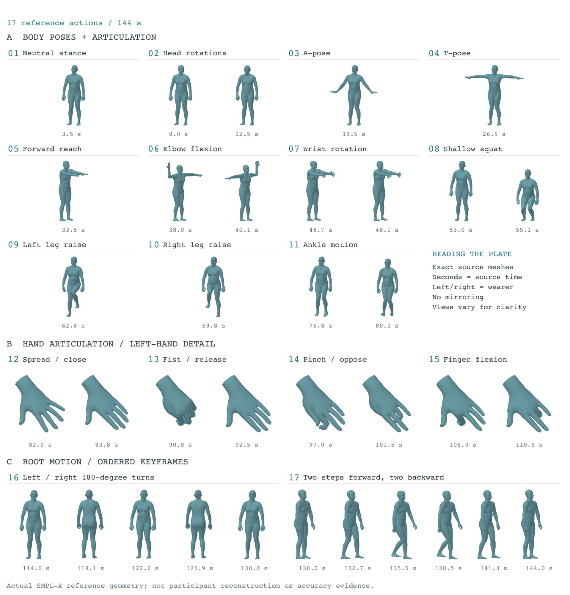

# 5. Calibration and calibration recordings

[Back to contents](../index.md#english) · [中文](../zh/05_calibration.md)

## 5.1 Why a separate calibration

A tracker reading depends on two unknowns at once: **where and how the device sits on the limb** (mounting extrinsics) and **how the limb moves** (joint pose). Fitted together, a mounting error quietly becomes a pose error. So the first step of C³ is: **for every donning, solve body shape, scale and the five mounting transforms from a prescribed sequence and freeze them.** Every task recording reuses that result unchanged.

Calibration writes a `subject_profile.json` containing:

- SMPL-X `betas` (10) and a metric `scale`
- the fixed transform (translation + rotation) of each of the five trackers relative to its joint
- body dimensions, a personal gait/turn prior (from stages 16–17), per-tracker residuals and other quality information

## 5.2 When to recalibrate

- A new subject
- Any tracker removed and re-attached, or a strap that visibly slipped
- New gloves or new hand mounts

As long as the mounts are unchanged, one profile can be reused across days and tasks. **A new mounting does not require retraining the network**: mounting extrinsics are removed before the network input (verified by swapping profiles).

## 5.3 The protocol (01–17, about 144 s)

Hold every static pose for at least 3 s; perform dynamic motions slowly, continuously and with controlled range. The collector follows the three-view reference video below (`assets/calibration_protocol_reference.mp4` in the toolkit). **Follow the "subject left/right" labels on the page; the left side of the screen is not the subject's left.**



<video src="../../assets/video/calibration_protocol_reference.mp4" controls muted loop playsinline width="100%"></video>

*Collectors follow this three-view reference video (front, left, right). The same file ships as `assets/calibration_protocol_reference.mp4` in the toolkit.*

| Stage | Duration | Motion | Used for |
|---|---:|---|---|
| 01 | 7 s | Neutral stance, toes forward, arms relaxed, looking ahead | Floor, height, initial root |
| 02 | 9 s | Body still; slowly look left, right, down, up, pausing 1 s at each end | Head mount rotation |
| 03 | 7 s | A-pose: arms ~45° down and out, palms down | Shoulder width, upper arm |
| 04 | 7 s | T-pose: arms horizontal, elbows straight, palms down | Arm span, shoulder–wrist length |
| 05 | 7 s | Arms straight forward, palms down | Hand tracker position and orientation |
| 06 | 8 s | Arms out to the side, palms turned up; flex right, left, right, left elbow (two rounds) | Upper/forearm length, hand extrinsics |
| 07 | 8 s | Arms forward; wrists palm-down, turn, pronate, supinate | Hand tracker rotation |
| 08 | 8 s | Two shallow squats, torso upright, feet fixed | Hip–knee–ankle lengths, floor |
| 09 | 7 s | Raise and lower the **subject's own** left leg twice without leaning | Left ankle extrinsics |
| 10 | 7 s | Raise and lower the subject's own right leg twice | Right ankle extrinsics |
| 11 | 7 s | In place, first lift the heels (rise onto the toes), then lift the toes (rock onto the heels) | Ankle tracker rotation |
| 12 | 7 s | Hands forward: spread, then close the fingers | Palm scale, glove static offset |
| 13 | 7 s | Slowly make a fist and fully open, twice | Finger flexion scale and zero |
| 14 | 9 s | Touch thumb to index, middle, ring, little finger in turn, then open | Opposition and pinch |
| 15 | 9 s | Fully flex and extend index, middle, ring, little finger in turn | Per-finger chain mapping |
| 16 | 16 s | Small-step turn in place: 180° left and back, then 180° right and back, head with torso | World yaw, turn continuity, L/R and front/back check |
| 17 | 14 s | Facing forward, two steps forward, then two steps back to the start | Gait, pelvis translation, floor-contact check |

**Requirements:**

- Flat, hard floor; tape a mark for each foot with the toes pointing the same way. The starting stance defines the reference left/forward of the world frame (chapter 11).
- Let the trackers settle after power-on and confirm all five share one global frame without dropouts.
- Record 3 s of standing still before the protocol.
- Trackers must not be removed or moved during calibration or the task recordings that follow.
- Stages 16–17 are dynamic acceptance stages: they feed the full-sequence reconstruction, the personal turn/gait prior and the web check, but **do not enter the static scale/shape equations** (the pelvis keeps moving while turning and walking; treating them as static points would corrupt shape and mounts).

## 5.4 Running `calibrate-subject`

A CPU is enough; run from the toolkit root:

```bash
# --data: folder with one or more 01–17 recordings of the same subject and the same donning; height and arm span in metres
PYTHONPATH=src python -m five_tracker_smplx.cli calibrate-subject \
  --data <calibration session root> \
  --height <height_m> --armspan <armspan_m> \
  --output-dir $WORK/profiles/<subject>_<date> \
  --body-model-path models/smplx \
  --vposer-path models/vposer/V02_05 \
  --motion-cache assets/calibration_motion_vposer_mano.npz \
  --iterations 1100 --optimized-betas 5 --device cpu
```

- Stage alignment is automatic: 01–11 use the trackers' position/rotation features, 12–15 add glove joint motion energy, 16–17 use the joint rotation and horizontal displacement of head and ankles. Each recording gets a `protocol_alignment.json` (stage bounds, confidence). Stages 16–17 are only appended when a real turn and walk are detected.
- If automatic alignment fails, stage bounds can be annotated by hand (`*_manual_alignment.json`) and used for calibration.
- Optional `--smplx-prior <npz>`: betas recovered from video (e.g. GVHMR) as a shape prior only, never as per-frame alignment. The production profiles use it (weight 0.18); without it the mounts barely change but shape and scale differ.
- Fitting principles: one translation/rotation per tracker for the whole sequence; release only the first few betas with height and arm span as strong constraints (fitting all 10 betas freely from five trackers is unobservable); the pelvis–neck angle to gravity is only a soft constraint.

**Outputs**: `subject_profile.json` (format `five_tracker_smplx_subject_profile_v5_wxyz_source_columns`) + `subject_calibration.html` (acceptance page). Once it passes, copy `subject_profile.json` to `$WORK/profiles/<batch>.json`, where chapter 7 picks it up.

## 5.5 Acceptance

Check in `subject_calibration.html`:

- 01–17 labels in order with correct stage boundaries;
- turning the head does not drag the torso; elbow flexion, wrists, shallow squats, leg raises and ankle motion look natural, with no left/right flip;
- feet flat and not sliding in static stages; turns made of alternating small steps; the walk is two steps forward and two back, four footfalls in total;
- no abnormal pelvis sway or frame-to-frame jumps;
- **in static stages the predicted-vs-measured tracker residual is stable and does not drift with motion.** If one tracker stays above about 3–4 cm, check strap slip and role mapping first, then the coordinate frame.

## 5.6 Which profile a task recording uses

**A profile belongs to a subject and a donning, not to a rig or a task.** Chapter 7 organises recordings into batches: a batch holds recordings of one subject in one donning, and the whole batch uses the profile calibrated for that donning.

- The same rig worn by someone else is a new batch and needs a new profile.
- Record in the capture log who recorded each session and which donning it belongs to.
- If the log is missing and you are unsure who recorded a session, look at head height (how far the head tracker sits above the ankle trackers when standing). It differs between people by several centimetres; compare it with the value in each profile's calibration recordings.

A wrong profile costs a lot: one session went from 62 mm RMS with the right profile to 80 mm with the wrong one.
