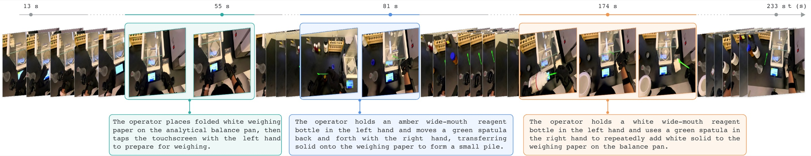

# 10. Converting to LeRobot v3.0

[Back to contents](../index.md#english) · [中文](../zh/10_lerobot_v3.md)

Released data uses the [LeRobotDataset v3.0](https://github.com/huggingface/lerobot) format. The converter is `scripts/build_lerobot_dataset.py` in the toolkit; its inputs are the outputs of the previous chapters: the raw recordings and `unified_30hz/`.



*Every recording carries step-level annotations: step number, description, start and end time, skill, object roles and outcome.*

## 10.1 Layout

```text
<dataset>/
├── meta/
│   ├── info.json                              fps=30, field types and shapes, path templates, coordinate system
│   ├── stats.json                             per-field statistics
│   ├── tasks.parquet                          task_index to task description
│   └── episodes/chunk-000/file-000.parquet    row range and video offset of each episode
├── data/chunk-000/file-NNN.parquet            per-frame data
├── videos/observation.images.camera_0/chunk-000/file-NNN.mp4
└── episode_meta/episode_XXXXXX/               extra information per episode (XXXXXX = episode_index + 1)
    ├── metadata.json                          recording, task, scene, time range, devices, crop, processing notes
    ├── calibration/calibration.json           camera intrinsics, tracker mounting, coordinate system, touch calibration, clocks
    ├── annotations/instruction.json           task instruction
    ├── annotations/segments.parquet           step annotations
    ├── quality/quality.json                   fit residuals, tracker interpolation statistics
    └── smplx/smplx_episode.npz                SMPL-X of the episode (same conventions as unified_30hz)
```

## 10.2 Per-frame fields

| Field | Type and shape | Notes |
|---|---|---|
| `timestamp` `frame_index` `episode_index` `index` `task_index` | scalars | `timestamp` is seconds within the episode and equals the mp4 display time |
| `tracker.<role>.position` | float32 (3) | Metres; `<role>` is camera, left_wrist, right_wrist, left_ankle or right_ankle |
| `tracker.<role>.orientation` | float32 (4) | Quaternion in **x, y, z, w** order (raw files are wxyz) |
| `tracker.<role>.rotation_6d` | float32 (6) | First two columns of the rotation matrix, order `r00, r10, r20, r01, r11, r21` |
| `gravity.direction` | float32 (3) | `(0, -1, 0)` |
| `observation.hand.{left,right}.joint_positions` | float32 (21, 3) | Glove joint points (21 nodes) |
| `observation.hand.{side}.tactile_17zone_contact` | float32 (17) | Contact per region (0 or 1) |
| `observation.hand.{side}.tactile_17zone_score` | float32 (17) | Score after baseline removal |
| `observation.hand.{side}.tactile_17zone_residual` | float32 (17) | Baseline residual |
| `observation.hand.{side}.tactile_17zone_coarse_contact`, `_coarse_score` | float32 (6) | Five fingers plus palm |
| `observation.images.camera_0` | video (970, 1920, 3) | Top 110 pixels cropped, strictly 30 fps |

Touch fields are NaN for hands without touch, such as MANUS recordings.

## 10.3 Running the conversion

**1. List the episodes** in a CSV file, one row per episode, in episode order:

```csv
session,task_zh,task_en,environment_type,trim_head_s,trim_tail_s
session_20260901_154755_物料称量,物料称量,Weighing,lab,0,5
session_20260916_112944_萃取,萃取,Extraction,lab,0,0
```

`environment_type` is `lab` or `home`; `trim_head_s` and `trim_tail_s` are optional and cut the start and end.

**2. Run**

```bash
python scripts/build_lerobot_dataset.py \
  --episodes episodes.csv \
  --raw-root $WORK/input/ego_data_sync \
  --unified-root $WORK/out/unified_30hz \
  --projected-root $WORK/out/projected \
  --output $WORK/out/lerobot
```

| Option | Meaning |
|---|---|
| `--projected-root` | Optional; adds fit residuals to `quality.json` |
| `--captions-root` | Optional; folder of `<recording>.en.jsonl` step annotations |
| `--crop-top` | Pixels cut from the top of the video, 110 by default (removes the GoPro status bar) |
| `--fx` `--fy` `--cx` `--cy` | Camera intrinsics written to `calibration.json`, default 1012 / 1016 / 960 / 430 |
| `--license` `--privacy-status` | Licence and privacy notes in the metadata |
| `--validate-only` | Check an existing dataset without converting |

Video encoding needs `ffmpeg` on the system. Videos already encoded are skipped, so an interrupted run resumes.

At the end the converter checks that every episode's parquet row count equals its video frame count and that `timestamp` lies on the 1/30-second grid (error below 1e-4 s). Measured on a 192-second Wuji recording: about one minute on a Mac CPU, 5,620 frames, video frames equal to rows, grid error 7×10⁻⁶ s; `LeRobotDataset` from `lerobot` 0.4.4 reads the first, middle and last frames (video decoding included) at its default tolerance.

## 10.4 What the converter does

1. **Re-encodes the video.** The raw mp4 has a variable frame rate, so `timestamp` and display time differ by up to about 25 ms, which breaks LeRobot's video reading at its default `tolerance_s = 1e-4`. The converter crops the top 110 pixels with ffmpeg and encodes at exactly 30 fps, after which frame k is displayed at exactly k/30 s.
2. **Uses the video frames as the timeline.** Trackers are interpolated from their native rate (about 65 Hz) to each video frame time: positions linearly, rotations by shortest-path Slerp. Across a native dropout longer than 0.25 s, or a jump of more than 0.10 m or 60° between neighbouring samples (tracker relocalisation or a bad frame), it does not interpolate and takes the nearer sample instead. Interpolation statistics per tracker go into `quality.json`.
3. **Writes quaternions as xyzw**, together with `rotation_6d`.
4. **Takes hands and touch from `unified_30hz`.** A hand missing there is recomputed from the raw glove file with the same touch processing, and its source is recorded in `metadata.json` and `info.json`. Regions without usable taxels get NaN score and residual and constant-zero contact, with the coverage of each region in `coverage_17`.
5. **Stores SMPL-X per episode** in `smplx_episode.npz` with the same keys as `unified_30hz`; shape, scale and mounting go into `calibration.json` instead of being repeated on every row.
6. **Writes the metadata**: `info.json`, `stats.json`, `tasks.parquet` and `episodes/…parquet`.

Before a release, also read every episode in full with `LeRobotDataset` at its default tolerance.

## 10.5 Reading the data

```python
from lerobot.datasets.lerobot_dataset import LeRobotDataset

ds = LeRobotDataset("InternRobotics/EgoExplorer", root="EgoExplorer/dataset/lerobot")
print(ds.meta.info["fps"], ds.num_episodes, ds.num_frames)
frame = ds[0]
frame["observation.images.camera_0"]          # (3, H, W)
frame["tracker.camera.orientation"]           # x, y, z, w
```

SMPL-X forward pass (same conventions as the gallery and review pages):

```python
import numpy as np, smplx, torch

z = np.load("episode_meta/episode_000001/smplx/smplx_episode.npz")
model = smplx.create("models", model_type="smplx", gender="neutral", use_pca=False, num_betas=10)
T = len(z["body_pose"]); zero = torch.zeros(T, 3)
out = model(betas=torch.tensor(z["betas"])[None].expand(T, -1),
            global_orient=torch.tensor(z["global_orient"]), body_pose=torch.tensor(z["body_pose"]),
            left_hand_pose=torch.tensor(z["left_hand_pose"]), right_hand_pose=torch.tensor(z["right_hand_pose"]),
            transl=zero, jaw_pose=zero, leye_pose=zero, reye_pose=zero, expression=torch.zeros(T, 10))
vertices = float(z["scale"]) * out.vertices.numpy() + z["transl"][:, None]   # same world frame as the trackers, +Y up
```

## 10.6 To decide before the full release

- **Meaning of the translation field.** `smplx_episode.npz` keeps the `unified_30hz` convention (vertices = scale × SMPL-X(transl=0) + transl), while the full release described in the paper and the HF data card stores the pelvis position in world coordinates (conversion in 11.4). Pick one before the full release and state it in `info.json`.
- **Video field name.** Currently `observation.images.camera_0`; the paper's appendix says `observation.images.ego`.
