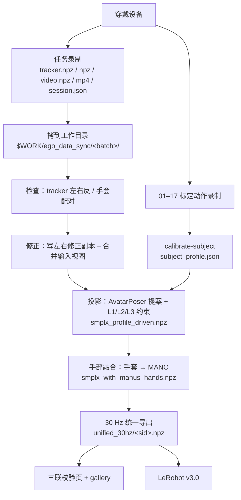

# 0. 总览与数据流

[返回目录](../index.md) · [English](../en/00_overview.md)

## 0.1 这套系统做什么

一个人穿着轻量化的可穿戴设备在真实场景（实验室、工厂、客厅、书房、厨房）里边走边干活，我们同步记录四路信号：

| | 信号 | 设备 | 原生速率（实测） |
|---|---|---|---|
| A | 第一视角视频 | GoPro HERO13 Black + Media Mod，经 3D 打印转接件与头部 tracker 刚性相连 | Wuji 方案实测约 30 Hz；MANUS 方案约 52–60 Hz |
| B | 全身运动 | 5 × VIVE Ultimate Tracker（头、双腕、双踝外侧），inside-out，无基站 | Wuji 方案约 65 Hz；MANUS 方案约 15 Hz（见第 2.2 节） |
| C | 手指关节 | MANUS Metagloves Pro **或** Wuji 手套 | MANUS 约 22 Hz（旧 25 点）/ 约 220 Hz（新 21 点）；Wuji 约 120 Hz |
| D | 触觉 | Wuji 手套，每手 24×31 = 744 个 taxel | 约 120 Hz |

然后用 **C³（Calibrate–Complete–Constrain）** 管线把稀疏的 5 个 tracker 变成完整、带尺度、物理上合理的 SMPL-X 人体，再把手套的手指姿态和触觉融合到同一个身体、同一条时间轴上。

**整条处理管线可以在一台机器上跑完**（推荐带一块 NVIDIA GPU），不依赖集群。

## 0.2 数据流

## 0.3 工具包里有什么

| 部分 | 内容 |
|---|---|
| `record_ego/` + `devices/` | 采集程序与设备驱动（第 3 章，待补充） |
| `src/five_tracker_smplx/` | 库：数据读取、坐标约定、标定、SMPL-X 拟合、手部映射、viewer |
| `scripts/` | 各阶段脚本：投影、检查、修正、导出、审阅页、gallery、训练 |
| `ckpt/` | v3 proposal 网络 checkpoint |
| `models/` | SMPL-X、VPoser（需从官网下载，见第 7.2 节） |

## 0.4 各章怎么读

- 第一次搭设备、组织采集：第 1–5 章。
- 只处理已有数据：第 6–10 章，配合第 11 章（坐标系）和第 12 章（环境与坑）。
- 写任何读这些 npz 的代码之前，**先读第 11 章和第 12.2 节**：采样率永远不统一、时间戳有相对/绝对之分、四元数顺序在原始文件和发布文件里不一样。
