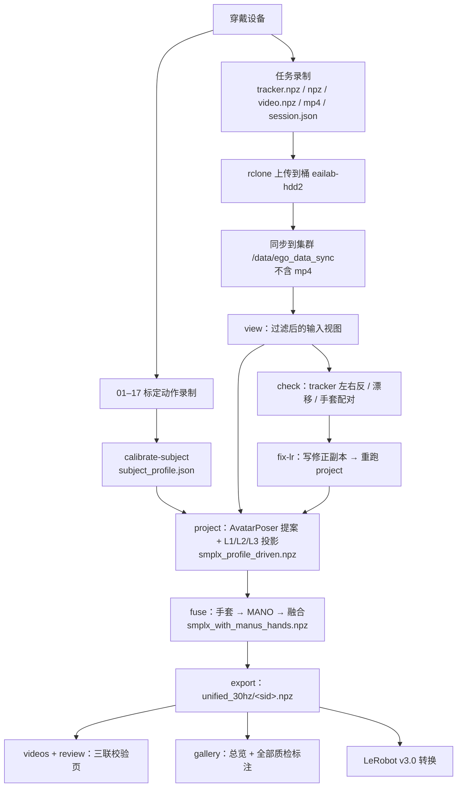

# 0. 总览与数据流

[返回目录](../index.md) · [English](../en/00_overview.md)

## 0.1 这套系统做什么

一个人穿着轻量化的可穿戴设备在真实场景（实验室、工厂、客厅、书房、厨房）里边走边干活，我们同步记录四路信号：

| | 信号 | 设备 | 原生速率（实测） |
|---|---|---|---|
| A | 第一视角视频 | GoPro HERO13 Black + Media Mod，经 3D 打印转接件与头部 tracker 刚性相连 | Wuji 方案实测 ~30 Hz；MANUS 方案 ~52–60 Hz |
| B | 全身运动 | 5 × VIVE Ultimate Tracker（头、双腕、双踝外侧），inside-out，无基站 | Wuji 方案 ~65 Hz；MANUS 方案 ~15 Hz（见第 12 章） |
| C | 手指关节 | MANUS Metagloves Pro **或** Wuji 手套 | MANUS ~22 Hz（旧 25 点）/ ~220 Hz（新 21 点）；Wuji ~120 Hz |
| D | 触觉 | Wuji 手套，每手 24×31 = 744 个 taxel | ~120 Hz |

然后用 **C³（Calibrate–Complete–Constrain）** 管线把稀疏的 5 个 tracker 变成完整、带尺度、物理上合理的 SMPL-X 人体，再把手套的手指姿态和触觉融合到同一个身体、同一条时间轴上。

## 0.2 数据流

## 0.3 代码与资源在哪

| 东西 | 位置 |
|---|---|
| 管线代码（H 集群） | `~/workspace/five_tracker_smplx`（`src/five_tracker_smplx/` 库 + `scripts/`） |
| 本地开发副本 | `robotics/five_tracker_smplx`（库）、`fivetrackerlocal/cluster_batch/`（批处理脚本，部署到集群 `scripts/`） |
| v3 完整归档（可离线复现） | 桶 `eailab-hdd2:/eailab/code/five_tracker_v3`：`code/` + `ckpt/` + `env/`（离线 wheelhouse）+ `batch_v3/`（产出） |
| v3 配置的唯一权威来源 | `scripts/batch_v3_env.sh` |
| 批处理入口 | `scripts/run_batch_v3.sh <stage>` |
| 原始录制 | 桶 `eailab-hdd2:/eailab/ego_data/<数据集>/`；集群同步副本 `/data/ego_data_sync/<数据集>/`（不含 mp4） |
| 录制端代码 | `record_ego/`（采集主程序）+ `devices/`（各设备驱动），见第 3 章 |

## 0.4 各章怎么读

- 第一次搭设备、组织采集：第 1–5 章。
- 只处理已有数据：第 6–10 章，配合第 11 章（坐标系）和第 12 章（集群与坑）。
- 写任何读这些 npz 的代码之前，**先读第 11 章和第 12.3 节**：采样率永远不统一、时间戳有相对/绝对之分、四元数顺序在原始文件和发布文件里不一样。
