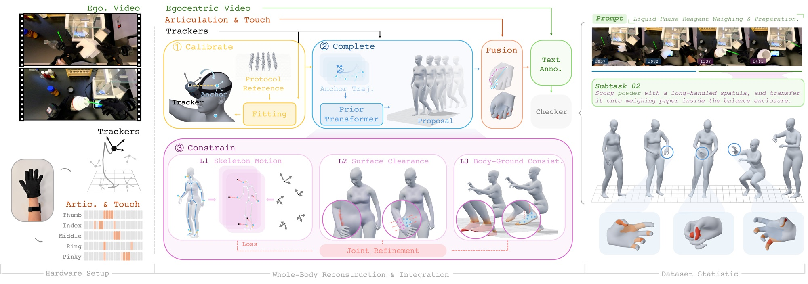
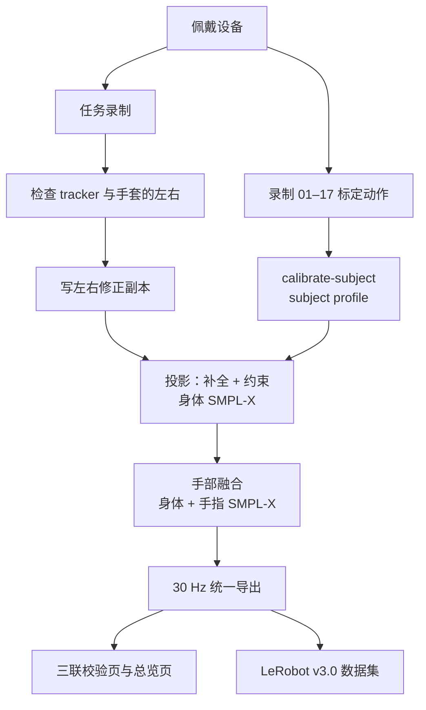

# 0. 总览

[返回目录](../index.md) · [English](../en/00_overview.md)

EgoExplorer 用一套可穿戴设备记录人在真实场景中边走边操作的过程：采集者戴上五个 tracker、一副手套和一台头戴相机，在实验室、工厂、客厅、书房或厨房里完成任务。设备同时记录四路信号，处理管线再把它们还原成带手指的 SMPL-X 人体，并对齐到同一条时间轴上。

<video src="../../assets/video/session_weighing.mp4" controls muted loop playsinline width="100%"></video>

*一条物料称量录制（5 倍速）：第一视角视频、全身运动、手部骨架与触觉、步骤描述共用一条时间轴。*

## 0.1 四路信号

| | 信号 | 设备 | 原生速率（实测） |
|---|---|---|---|
| A | 第一视角视频 | GoPro HERO13 Black + Media Mod，与头部 tracker 刚性相连 | Wuji 方案约 30 Hz；MANUS 方案约 52–60 Hz |
| B | 全身运动 | 5 个 VIVE Ultimate Tracker：头、双手手背、双踝外侧 | Wuji 方案约 65 Hz；MANUS 方案默认 90 Hz（旧录制约 15 Hz） |
| C | 手指关节 | MANUS Metagloves Pro 或 Wuji 手套 | MANUS 约 220 Hz（旧版 25 节点约 22 Hz）；Wuji 约 120 Hz |
| D | 触觉 | Wuji 手套，每只手 24×31 = 744 个触点 | 约 120 Hz |

## 0.2 处理流程

稀疏的五个 tracker 不足以直接确定全身姿态。重建分三步（C³：Calibrate–Complete–Constrain）：

1. **标定（Calibrate）**：每次佩戴先做一段规定动作，解出体型、尺度和五个 tracker 的安装位置，之后的录制都沿用这份结果；
2. **补全（Complete）**：时序网络根据五个 tracker 给出整段全身轨迹，补上 tracker 看不到的关节；
3. **约束（Constrain）**：在 tracker、身体自身表面和地面三层约束下优化这条轨迹。

身体解出来以后，再把手套测到的手指姿态和触觉挂到同一个身体上，统一重采样到 30 Hz。

整条处理管线可以在一台机器上完成，推荐配一块 NVIDIA GPU。

## 0.3 代码

代码在 [InternRobotics/egoexplorer-toolkit](https://github.com/InternRobotics/egoexplorer-toolkit)。

| 目录 | 内容 |
|---|---|
| `capture/` | 采集程序，支持 Wuji 和 MANUS 两种手套（第 2–4 章） |
| `src/five_tracker_smplx/` | 库：数据读取、坐标约定、标定、SMPL-X 拟合、手部融合 |
| `scripts/` | 各处理阶段的脚本，单机入口 `scripts/run_pipeline.sh` |
| `tactile/` | Wuji 触觉处理与手套健康表 |
| `ckpt/` | 补全阶段用的网络权重 |
| `assets/` | 标定参考动作与参考视频 |
| `hardware/` | 采购清单与 3D 打印件 |
| `models/` | SMPL-X 与 VPoser，需从官网下载（第 7.2 节） |

## 0.4 阅读顺序

- **搭建设备、组织采集**：第 1–5 章。
- **处理已有数据**：第 6–10 章。
- **写代码读取数据之前**：先看第 11 章（坐标系）和第 12.2 节。三个容易出错的地方：各路信号的采样率都不一样；有的时间戳是相对时间，有的是绝对时间；原始文件和发布文件的四元数顺序不同。
