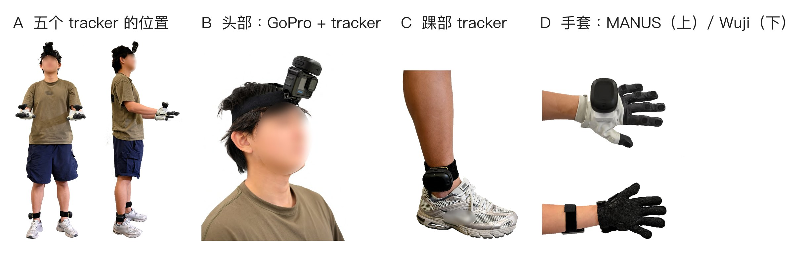

# 1. 硬件与佩戴

[返回目录](../index.md) · [English](../en/01_hardware_and_wearing.md)

## 1.1 采购清单

| 部件 | 型号 | 数量 | 购买链接 | 说明 |
|---|---|---|---|---|
| 身体 tracker | VIVE Ultimate Tracker（含无线接收器） | 5 | [淘宝](https://e.tb.cn/h.j2riSa4h9gOXIbP?tk=bTaNTF8KLgN) | 自带摄像头定位，不需要基站 |
| 头部相机 | GoPro HERO13 Black | 1 | [淘宝](https://e.tb.cn/h.jX74wO5kS7nAy2D?tk=eQhiTF8vq0V) | |
| 媒体模组 | GoPro Media Mod（HERO13/12/11 通用） | 1 | [淘宝](https://e.tb.cn/h.jWg7Rd1eJVpQFGl?tk=sRXrTF8xGCs) | 提供 micro-HDMI 输出 |
| HDMI 采集卡 | 绿联 4K60Hz USB 采集卡（UVC） | 1 | [京东](https://3.cn/37Yq-tog?jkl=@Q3DcI0h3Iu7W@) | Linux 下识别为 `/dev/videoN` |
| 视频线 | micro-HDMI 转 HDMI | 1 | [京东](https://3.cn/37YriR-s?jkl=@XB71C3CgoM8X@) | |
| 手套（二选一） | MANUS Metagloves Pro | 1 副 | 待补充 | 只有手指关节 |
| | Wuji 手套 | 1 副 | 待补充 | 手指关节，加每只手 24×31 触觉；以太网连接 |
| USB 网卡 | 绿联 USB 3.0 千兆网口扩展坞 | 2 | [京东](https://3.cn/37-YsP1x?jkl=@VER0R1iYlA3G@) | Wuji 方案，每只手套一个网口 |
| 绑带 | VIVE tracker 绑带、GoPro 头带 | 头带 1，绑带 4 | [tracker 绑带](https://e.tb.cn/h.jX7EVqK0xb7nHvB?tk=vOtgTFj8BVK) · [GoPro 头带](https://e.tb.cn/h.jc684WNxd6oG6gN?tk=BdM7TFj9A15) | |
| Linux 采集机 | Ubuntu 22.04 及以上 | 1 | — | 仅 Wuji 方案；可用便携设备 |
| Windows 主机 | 运行 SteamVR | 1 | — | Wuji 方案只负责 tracker；MANUS 方案负责全部采集 |

## 1.2 3D 打印件

STL 文件和打印参数放在 [egoexplorer-toolkit](https://github.com/InternRobotics/egoexplorer-toolkit) 的 `hardware/3d_print/`（整理中）。

| 打印件 | 用途 | 文件 | 数量 |
|---|---|---|---|
| 头部转接件 | 把 GoPro 和头部 tracker 刚性连接，再装到头带上 | `gopro-tracker.stl` | 1 |
| 手背底座 | 把 tracker 固定在手套手背 | `wuji-contact.stl` | 2 |

## 1.3 tracker 的角色

每个 tracker 在 SteamVR 里分配一个角色，采集程序、处理管线和发布数据都用这套名字：

| SteamVR 角色 | 管线内的名称 | 佩戴位置 | SMPL-X 关节 |
|---|---|---|---|
| `camera` | `head` | 头部，与 GoPro 刚性相连 | 15 |
| `left_wrist` | `left_hand` | 左手手背 | 20 |
| `right_wrist` | `right_hand` | 右手手背 | 21 |
| `left_ankle` | `left_foot` | 左踝外侧 | 7 |
| `right_ankle` | `right_foot` | 右踝外侧 | 8 |

左右一律指**佩戴者自己的**左右。面对佩戴者时，他的左手在你的右侧。任何环节都不能按画面左右调换角色。

头部 tracker 和 GoPro 刚性相连，所以相机位姿可以直接由 tracker 读出，不需要事后用视觉方法估计。这要求两者之间没有相对运动：转接件拧紧，头带不松动。录制中相机一旦被碰歪，这段录制的相机位姿就不能再用。

## 1.4 佩戴步骤

两人配合效果最好：一人佩戴，一人检查。

1. **量身高和臂展**（新采集者，或重新标定之前）。臂展量中指尖到中指尖，各量两次取平均，标定时以米为单位输入。其它尺寸（肩宽、上臂、前臂、手长等）可以一并记下备查。
2. **戴手套，确认左右。** Wuji 手套按序列号区分左右，在采集页面上核对左右手是否显示在正确一侧。
3. **装手背 tracker。** 底座贴在手套手背中央，绑带勒到手腕活动时 tracker 不晃动。左手戴 SteamVR 角色为 `left_wrist` 的那一个，右手同理。
4. **装踝部 tracker。** 装在脚踝外侧、踝骨上方，勒到走路和下蹲时不转、不滑。同样注意角色。
5. **戴头带、头部 tracker 和 GoPro。** 头带调到不晃动，相机朝向自然平视的方向。
6. **拍两张安装照片**（正面、侧面），出问题时用来核对 tracker 的位置和朝向。
7. **静置自检。** 佩戴者自然站立几秒，在采集页面确认：五个 tracker 都在线且没有跳变，两只手套都有数据，视频有画面（页面样子见第 3.4 节）。

## 1.5 佩戴规则

!!! warning "这几条直接决定数据能不能用"

    - **标定和任务录制必须来自同一次佩戴。** 拆装 tracker、绑带滑动或换人之后，都要重新录标定（第 5 章）。安装位置变了，事后的坐标修正补不回来。
    - **任务之间不要调整 tracker。** 每次佩戴只解一份安装参数。
    - **左右要和 SteamVR 角色一致。** 戴反会直接导致 SMPL-X 解错。
    - **绑带要勒紧。** tracker 慢慢滑动时，每一帧单看都正常，误差会被悄悄算进身体姿态。

**Wuji 触觉。** 手套的触觉灵敏度会随使用慢慢下降，个别线路会时断时续。建议每段录制开始前在 Wuji Studio 里重新做一次触觉标定（约 15 秒），方便逐段估计手套状态。
