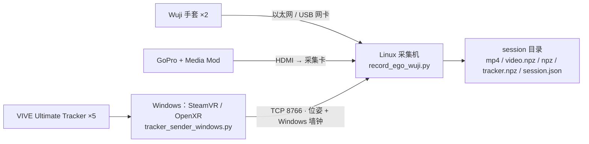
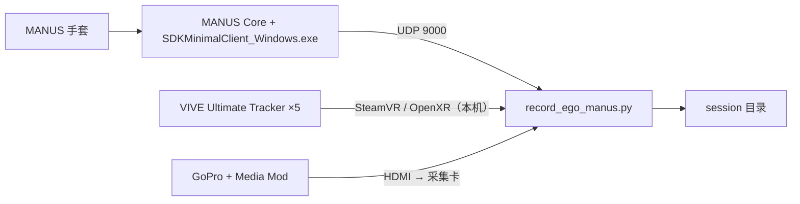

# 2. 采集主机设置

[返回目录](../index.md) · [English](../en/02_host_setup.md)

采集代码在 [egoexplorer-toolkit](https://github.com/InternRobotics/egoexplorer-toolkit) 的 `capture/` 目录：一套代码同时支持 **Wuji** 和 **MANUS** 两种手套，入口分别是 `record_ego_wuji.py` 和 `record_ego_manus.py`。

## 2.1 两种拓扑

### Wuji 方案：Linux 采集机 + Windows tracker 机



- Linux 是唯一的采集协调端。视频和手套直接用 Linux 墙钟打时间戳。
- Windows 每帧发送位姿和自己的墙钟时间。两端每 2 秒做一次 NTP 式四时间戳采样，Linux 用最低 RTT 的样本估计 `Windows − Linux` 时钟偏移，把 tracker 时间换算到 Linux 墙钟。校时完成前用 Linux 收包时间；检测到超过 5 秒的异常偏移时也会回退到收包时间。
- 实测 session 内总漂移中位数 4.2 ms，拟合抖动 0.39 ms。

### MANUS 方案：单台 Windows 主机



三路数据在同一台机器、同一个墙钟上打时间戳，落盘即对齐。MANUS 发送端发出 25 节点骨骼，采集端丢掉 4 个非拇指掌骨关节，以 **21 节点（与 Wuji / MediaPipe 一致）** 落盘。

## 2.2 Windows 端：SteamVR 与 tracker

1. 安装 **VIVE Hub** 和 **SteamVR**，把 5 个 Ultimate Tracker 配对到无线接收器，按 VIVE Hub 的流程建好场地地图（inside-out 定位需要）。
2. 在 SteamVR 里把 **SteamVR 设为当前的 OpenXR Runtime**。
3. 给每个 tracker 分配角色：`camera`、`left_wrist`、`right_wrist`、`left_ankle`、`right_ankle`。
   - **角色为 "Handheld object" 的 tracker 不会产生可用位姿**，要换成上面这些角色。
   - 发送端启动时会打印枚举到的序列号和角色，可据此核对。
4. 安装 Windows 端依赖（只有 `numpy`、`msgpack`、`pyopenxr`）：
   ```powershell
   python -m venv .venv-tracker
   .\.venv-tracker\Scripts\Activate.ps1
   python -m pip install -r requirements-tracker-windows.txt
   ```

**tracker 帧率**：
- Wuji 方案：发送端默认最多 90 FPS（`--send-fps 90`），Linux 端写入上限 120 FPS（`--tracker-record-fps`）。必须限速，因为部分 headless OpenXR Runtime 的 `wait_frame` 会立即返回，不限速会产生近千 FPS 的重复位姿，挤占 Linux 上的手套接收。
- MANUS 方案：本机 tracker 按**主机时钟**采样（`--tracker-sample-fps`，默认 90）。headless SteamVR 的合成器只有约 15 Hz，但 `xrLocateSpace` 可以随时查询，所以采样不再受帧节拍限制；完整的 wait/begin/end 帧每 0.5 s 才走一次，用来维持会话。**修复前的旧 MANUS 录制 tracker 只有约 15 Hz**（第 6.5 节）。

## 2.3 Linux 端（Wuji 方案）

建议 Ubuntu 22.04 或更新版本（Wuji SDK 要求），Python 3.10 / 3.11。

```bash
cd capture
python3 -m venv .venv && source .venv/bin/activate
python -m pip install -r requirements.txt      # numpy / opencv-python / msgpack / av / Pillow / wuji-sdk
```

**连接 Wuji 手套。** 每只手套各接一个网口（通常是 USB 以太网卡），官方默认地址左手 `192.168.1.100`、右手 `192.168.1.101`。用自动配置脚本完成网卡、路由和连接验证：

```bash
./scripts/setup_wuji_gloves.sh                     # 自动探测网口，创建持久化 NetworkManager 配置，扫描并连接验证
./scripts/setup_wuji_gloves.sh --check             # 只检查，不修改
./scripts/setup_wuji_gloves.sh --interface enx001 --interface enx002   # 自动候选不明确时显式指定网卡
./scripts/setup_wuji_gloves.sh --expected-gloves 2 --allow-ufw         # 要求两只都在线；UFW 启用时放行 SDK 端口
```

脚本不会清空已有网卡地址，也不会改承载默认路由的网卡。手套 IP 改过时用 `--left-ip`、`--right-ip`、`--host-prefix` 指定。

**Wuji 标定 bundle**：采集程序启动时会导入 `wuji_calibration/` 下的手套标定（`--wuji-calibration` 指定路径，`--no-wuji-calibration` 跳过并使用 SDK 当前用户）。这个目录来自 Wuji 官方标定工具，不在仓库里，向设备负责人获取。

**采集卡**：

```bash
sudo apt install v4l-utils
v4l2-ctl --list-devices
v4l2-ctl -d /dev/videoN --list-formats-ext
```

视频抓帧和编码在独立线程里进行，用有界队列连接；MP4 的 PTS 取自每帧抓取时刻的 `t_host_us`（可变帧率），所以即使中间丢帧，播放时间也不会被压缩。

**防火墙**：Windows 发送端要能访问 Linux 的 TCP 8766。

```bash
hostname -I                                               # 查看 Linux 局域网 IP
sudo ufw allow from <WINDOWS_IP> to any port 8766 proto tcp
```

不要把 8766 暴露到公网；在局域网里也建议两端设置相同的 `--tracker-token`（或环境变量 `EGO_TRACKER_TOKEN`）。

## 2.4 MANUS 方案的 Windows 采集机

- 依赖同 `requirements.txt`（Windows 上会装 `pyopenxr`，不装 `wuji-sdk`）。
- 运行 `ManusClient/SDKMinimalClient_Windows.exe`（`ManusSDK.dll` 放在同一目录），把发送目标设成采集端的 IP 和端口（默认 `0.0.0.0:9000`）。
- 采集卡在 Windows 上走 DirectShow。

## 2.5 采集前自检清单

- [ ] 五个 tracker 在 SteamVR 里角色正确、全部在线
- [ ] Wuji：`setup_wuji_gloves.sh --check` 通过，两只手套都能扫描到；已关闭 Wuji Studio（它会占用 SDK）
- [ ] MANUS：UDP 发送端已启动，目标 IP / 端口正确
- [ ] 采集页面顶部显示"Tracker 已连接"，相机预览和 tracker 3D 位姿正常
- [ ] 磁盘剩余空间充足
