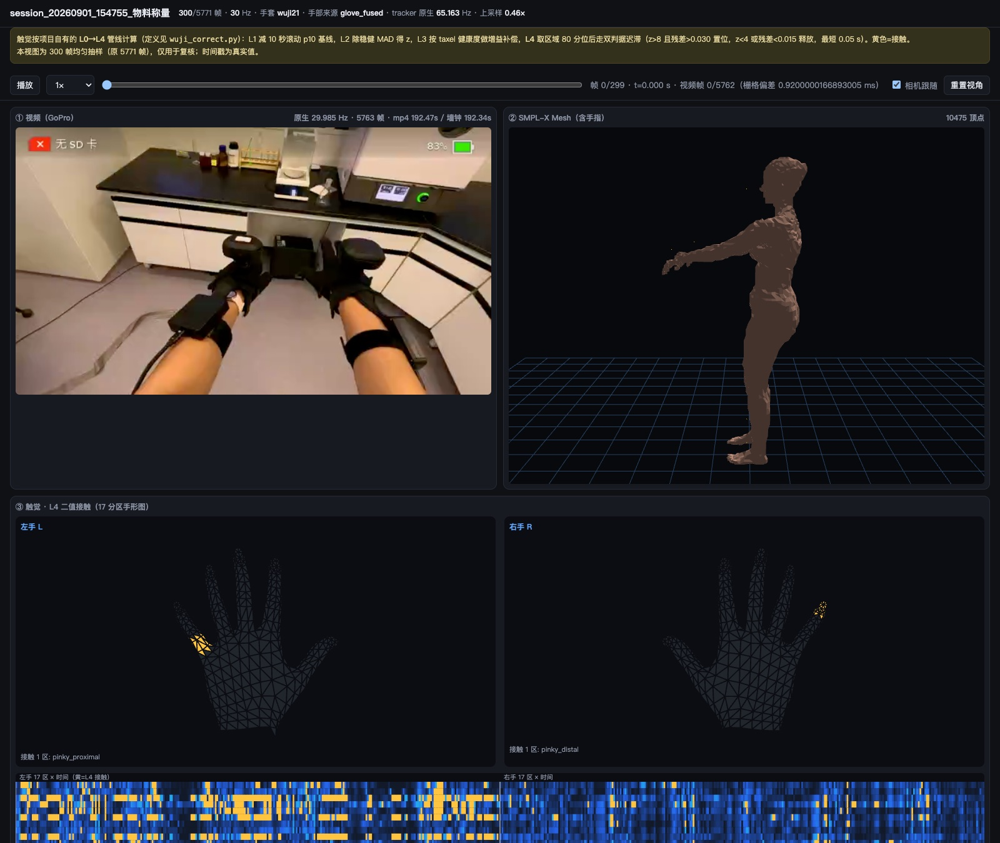

# 9. 质检与三联校验

[返回目录](../index.md) · [English](../en/09_review_and_qc.md)

质检分两部分：**自动检查**在投影前后运行，查左右是否装反、tracker 是否漂移、手套配对是否正确，结果汇总到总览页；**三联校验**是人工逐条查看，把同一时刻的视频、SMPL-X 和手部触觉放在一起比对。

本章的命令都在工具包根目录下执行，沿用第 7.3 节的变量。检查结果统一写到 `$WORK/out/gallery/`，总览页会读取它们。

## 9.1 自动检查

以下检查在投影**之前**运行，只读原始录制。其中两项需要标定，所以按 batch 分别运行：

```bash
G=$WORK/out/gallery; mkdir -p $G
B=<batch>; P=$WORK/profiles/$B.json
python scripts/check_tracker_lr.py     --sync-root $WORK/ego_data_sync --datasets $B --profile $P --output $G/tracker_lr.$B.json
python scripts/check_startup_stance.py --sync-root $WORK/ego_data_sync --datasets $B --profile $P --output $G/startup_stance.$B.json
python scripts/check_glove_sync.py     --sync-root $WORK/ego_data_sync --datasets $B --output $G/glove_sync.$B.json
python scripts/check_hand_identity.py  --sync-root $WORK/ego_data_sync --datasets $B --output $G/hand_identity.$B.json
```

有多个 batch 时，把各自的 `tracker_lr.<batch>.json` 合并成一个 `tracker_lr.json`，`glove_sync` 同理。这些文件都是 JSON 列表，直接拼接即可。

漂移检查要用投影残差，在投影**之后**运行：

```bash
python scripts/check_tracker_drift.py --sync-root $WORK/input/ego_data_sync \
  --projected $WORK/out/projected --output $G/tracker_drift.json
```

| 检查 | 脚本 | 判据 |
|---|---|---|
| tracker 左右装反 | `check_tracker_lr.py` | 用头部安装参数求出佩戴者的左方向，再看每对 tracker 的"左减右"在这个方向上的投影。正常情况下全程为正。用开头的站姿判断：双脚一直靠得很近时，"四肢分得最开的那几帧"并不可靠 |
| tracker 漂移、脱落 | `check_tracker_drift.py` | 几分钟内身体可以看作刚体：头到手腕、脚踝的距离随动作起伏，但不会持续变长或变短。给出两个量：这段距离的线性趋势 `trend_m`，以及该 tracker 的残差从前五分之一到后五分之一的增长 `residual_growth_mm` |
| 手套配对与时序 | `check_glove_sync.py` | MANUS 手套的根节点带朝向，把它的角速度和手腕 tracker 的角速度做互相关：峰值处的延迟就是时序偏差，交叉配对的相关性更高就说明左右反了。先重采样到 30 Hz 再差分，角速度截断到 20 rad/s 以排除坏帧。Wuji 手套的根节点没有朝向，结果记为 `unsupported` |
| 手套手性 | `check_hand_identity.py` | 根据骨架本身的手性逐帧判断每路数据来自哪只手，可以直接确定 `slot` |
| 起始站姿 | `check_startup_stance.py` | 检查开头几秒的几何关系是否合理，例如两个手腕相距好几米说明有漂移 |
| 拟合残差 | `tracker_diagnostics.npz` | 每个 tracker 残差的中位数超过 15 mm 记为偏高，超过 60 mm 记为异常；整体 75% 分位只有 4–12 mm |

判读时注意：

- 一动不动的 tracker 会被误判成左右装反（两个固定位姿相减也是一个固定向量），先确认它在动。
- 手套的判断是相对于手腕 tracker 的。如果手腕 tracker 本身装反了，手套的结论要反过来：实际是否交换 = 手套判为交换 XOR 手腕 tracker 判为交换。

## 9.2 修正

```bash
python scripts/fix_tracker_lr.py --report $G/tracker_lr.json \
  --sync-root $WORK/ego_data_sync --output-root $WORK/ego_data_lr_fixed
python scripts/fix_glove_lr.py   --report $G/glove_sync.json --tracker-report $G/tracker_lr.json \
  --sync-root $WORK/ego_data_sync --output-root $WORK/ego_data_lr_fixed
```

- 两个脚本都支持 `--dry-run`，先列出会改哪些录制。
- 修正结果写到平行目录 `$WORK/ego_data_lr_fixed/<batch>/<录制名>/`，**原始数据不会被修改**。没改的文件用链接，修正副本可以直接作为输入。
- tracker 修正交换左右两路 tracker，并在 npz 里写入 `tracker_lr_correction`；手套修正只改写 `session.json`，交换两只手套的 `slot`，并在 `glove_lr_correction` 中记录依据。
- 修正后按第 7.5 节建立合并输入，投影和手部融合都从合并输入读取。如果之前已经投影过，删掉被修正录制在 `references/`、`proposals/`、`projected/` 下的结果再重跑。

## 9.3 三联校验页

每条录制生成一个可以单独打开的 `<slug>.review.html`。`slug` 取 `session_<日期>_<时间>`，不含中文任务名，因为 Chrome 不加载文件名带中文的媒体文件；名字冲突时加后缀区分。`run_pipeline.sh review` 会自动完成以下三步：

```bash
R=$WORK/out/review; mkdir -p $R
for npz in $WORK/out/unified_30hz/*.npz $WORK/out/unified_30hz_nobody/*.npz; do
  name=$(basename "$npz" .npz)
  slug=$(printf '%s' "$name" | sed -E 's/^(session_[0-9]+_[0-9]+).*/\1/')
  mp4=$(ls $WORK/ego_data_sync/*/"$name"/"$name".mp4 2>/dev/null | head -1)
  # 1. 生成 360p、15 fps 的视频副本，用于页面内播放
  [ -n "$mp4" ] && [ ! -f $R/$slug.360.mp4 ] && ffmpeg -y -v error -i "$mp4" -vf "scale=-2:360" -r 15 \
      -c:v libx264 -preset veryfast -crf 32 -an -movflags +faststart $R/$slug.360.mp4
  # 2. 生成数据（抽帧、压缩后的网格）
  python scripts/build_review_payload.py --unified "$npz" --output-dir $R --body-model-path models/smplx --max-frames 300
  [ "$name" != "$slug" ] && mv -f $R/$name.payload.json $R/$slug.payload.json && mv -f $R/$name.mesh.i8c.gz $R/$slug.mesh.i8c.gz
  # 3. 生成页面
  v=(); [ -f $R/$slug.360.mp4 ] && v=(--video)
  python scripts/make_review_html.py $R/$slug.payload.json --slug $slug "${v[@]}"
done
```



*在一台机器上用工具包处理一条物料称量录制得到的校验页。左上是 GoPro 视频，右上是带手指的 SMPL-X，下方是左右手 17 个区域的接触（黄色为接触）和区域随时间的接触条带。页面顶部注明了触觉阈值和抽帧情况。*

页面的三栏都来自同一个 30 Hz 导出，所以拖动滑块时，视频帧、网格姿态和触觉读数天然是同一时刻，页面不需要自己去对齐：

1. **第一视角视频**（360p 副本）；
2. **SMPL-X 全身网格**，加上五个 tracker。每帧 10,475 个顶点，默认均匀抽取不超过 300 帧，压缩后直接写在页面里；
3. **双手与触觉**：手部骨架和 17 个区域的接触，接触的区域高亮并列出名称。

投影失败的录制也会生成页面（来自 `unified_30hz_nobody/`），只有视频和触觉，网格一栏写明失败原因。

!!! note "说明"
    页面的数据直接写在 HTML 里（`const P = …`），修改旁边的 `.payload.json` 不会生效，要重新生成页面。网格最多 300 帧，长录制在页面上只有 0.6–2 Hz，看起来卡顿是抽帧造成的，不是编码问题。需要全帧率时直接读 `unified_30hz` 的 npz。

## 9.4 总览页

```bash
python scripts/build_ego_gallery.py --batch-root $WORK/out --output-dir $WORK/out/gallery \
  --sync-root $WORK/input/ego_data_sync --body-model-path models/smplx --device cpu --title "EgoExplorer review"
```

`gallery/index.html` 是单个文件，双击即可打开：

- 每条录制一张卡片，包括三个固定尺寸画框（宽 1.5 m、高 2.25 m，地面线位置不变）里的骨架投影和五个 tracker 实测点、残差曲线、根节点轨迹缩略图和统计量。画框故意不自动缩放，这样"人沉到地面以下""尺度异常"这类问题一眼就能看出来；
- 可以按残差、旋转、位移排序，按任意一项检查结果筛选；失败的录制也会列出原因；
- 每张卡片链接到对应的三联校验页（默认在 `../review/`）。

## 9.5 人工复核要点

| 看什么 | 正常情况 | 不正常时先查 |
|---|---|---|
| 身体与视频是否同步 | 转身、伸手、下蹲与视频同时发生 | 时间戳换算、`video_time_offset_s` |
| 左右 | 视频里用右手拿东西，网格上也是右手 | tracker 或手套左右（9.1） |
| 脚 | 支撑脚不穿地、不悬空、不滑动 | 地面估计、L3 权重、躯干前倾上限 |
| 弯腰、深蹲、坐下 | 躯干确实前倾，而不是整个人往下沉 | 躯干前倾上限是不是还停在 15° |
| 手指 | 朝掌心弯曲，没有反折 | 手套左右、左手的镜像方向 |
| 触觉 | 接触区域和时刻与视频里手碰到物体的位置、时间一致 | 手套左右、手套健康表 |
| 残差曲线 | 平稳，在几毫米到一两厘米之间 | 绑带滑动、tracker 脱落、用错标定 |

复核结果（通过、有问题、需重录）建议按录制名记在一张表里，之后挑选发布数据时直接用。
